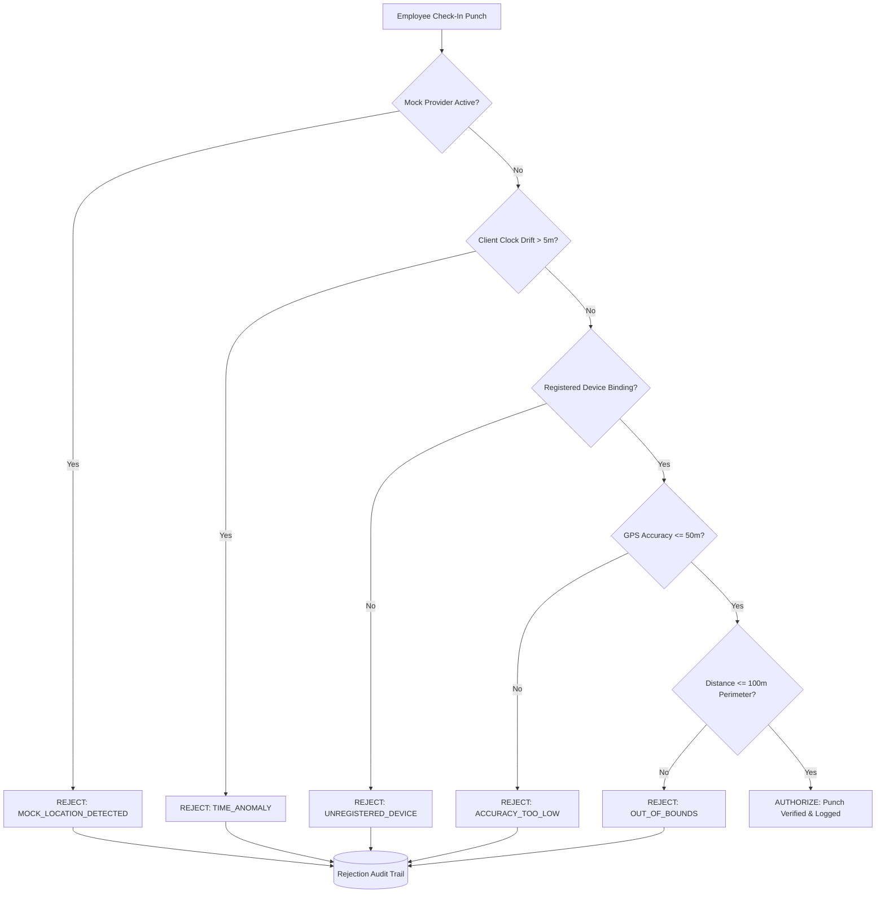

# ALS Architecture & Security Deep-Dive

This document details the spatial mathematics, anti-spoofing heuristics, and enterprise architectural principles underpinning the **Attendance Log System (ALS)**.

---

## 1. Geodesic Distance Mathematics (Haversine Formula)

To enforce strict, tamper-proof 100-meter physical office boundaries without external commercial mapping API dependencies, ALS implements a high-precision spherical geodesics engine:

$$\Delta\sigma = 2 \arcsin \left( \sqrt{\sin^2\left(\frac{\Delta\phi}{2}\right) + \cos(\phi_1) \cdot \cos(\phi_2) \cdot \sin^2\left(\frac{\Delta\lambda}{2}\right)} \right)$$

$$d = R \cdot \Delta\sigma$$

Where:
- $\phi_1, \phi_2$: Latitude of employee and office in radians.
- $\lambda_1, \lambda_2$: Longitude of employee and office in radians.
- $R = 6,371,000\text{ m}$: Mean Earth radius.
- $d$: Geodesic surface distance in meters.

### Geofence Verification Rule:
```typescript
export function isPointWithinRadius(
  pointLat: number,
  pointLon: number,
  centerLat: number,
  centerLon: number,
  radiusMeters: number
): boolean {
  const distance = calculateDistanceMeters(pointLat, pointLon, centerLat, centerLon);
  return distance <= radiusMeters;
}
```

---

## 2. Multi-Layer Hardware Anti-Spoofing Protocol

ALS evaluates every attendance punch against a 5-step heuristic pipeline:



---

## 3. Offline-First Synchronization Protocol

In subterranean sites, multi-story basements, or remote zones with zero cellular connectivity:
1. The mobile client captures the device timestamp, GPS telemetry, and biometric signature.
2. The payload is encrypted and queued in local persistent storage (`IndexedDB` / `SQLite`).
3. Upon network restoration, the background sync engine transfers queued punches in chronological FIFO order with server-side validation against tamper timestamps.

---

## 4. Microsoft SQL Server Relational Schema

```sql
-- Core Attendance Logs Table
CREATE TABLE dbo.AttendanceRecords (
    AttendanceId UNIQUEIDENTIFIER PRIMARY KEY DEFAULT NEWID(),
    EmployeeId UNIQUEIDENTIFIER NOT NULL FOREIGN KEY REFERENCES dbo.Employees(EmployeeId),
    OfficeId UNIQUEIDENTIFIER NOT NULL FOREIGN KEY REFERENCES dbo.Offices(OfficeId),
    PunchedAt DATETIMEOFFSET NOT NULL,
    PunchType NVARCHAR(20) NOT NULL, -- CHECK_IN, CHECK_OUT
    Latitude FLOAT NOT NULL,
    Longitude FLOAT NOT NULL,
    AccuracyMeters FLOAT NOT NULL,
    DistanceFromOfficeMeters FLOAT NOT NULL,
    PunchSource NVARCHAR(30) NOT NULL, -- MOBILE_GPS, BIOMETRIC, OFFLINE_SYNC
    IsVerified BIT NOT NULL DEFAULT 1,
    DeviceId NVARCHAR(100) NOT NULL,
    Notes NVARCHAR(255) NULL
);
```

Full T-SQL schema with indices and foreign key cascades is maintained in the private core repository.
