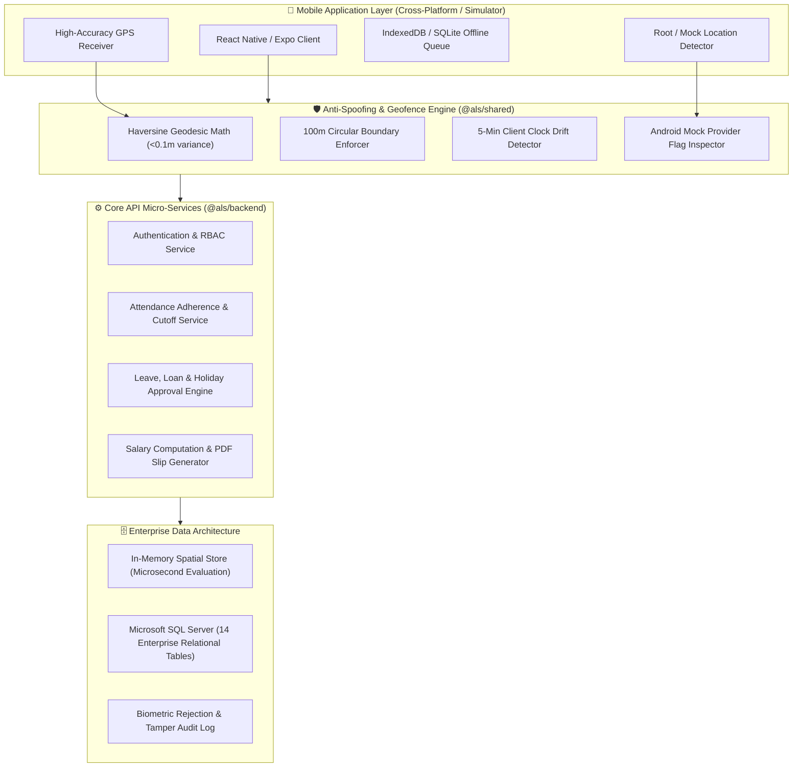

# Attendance Log System (ALS) — Enterprise Workforce Suite

<p align="center">
  
</p>

<p align="center">
  <strong>Smart Workforce. Seamless Attendance. Intelligent Management.</strong>
</p>

<p align="center">
  <a href="#-live-interactive-demonstration"></a>
  <a href="#-mobile-application-simulator"></a>
  <a href="https://github.com/sajjadali4441-web"></a>
</p>

<p align="center">
  
  
  
  
  
  
  
</p>

---

## 🎯 Executive Overview

**Attendance Log System (ALS)** is a mission-critical, enterprise-grade attendance and human resource management platform. Engineered to eliminate proxy punching ("buddy-punching") and fraudulent clock-ins, ALS couples **sub-meter geospatial geofencing (100m circular perimeter)** with **hardware anti-spoofing heuristics** and an interactive banking-style executive management portal.

Recruiters, hiring managers, and clients can explore the complete live application without requiring any authentication roadblocks or administrative sign-ins.

```
┌─────────────────────────────────────────────────────────────────────────┐
│                           CORE ALS MODULES                              │
├────────────────────┬────────────────────┬───────────────────────────────┤
│ 1. Admin Portal    │ 2. Mobile Client   │ 3. Spatial Geofencing Engine  │
│ 4. Daily Console   │ 5. Leaves & Loans  │ 6. Payroll & PDF Salary Slips │
└────────────────────┴────────────────────┴───────────────────────────────┘
```

---

## 🚀 Live Interactive Demonstration

Explore the live cloud-deployed system instantly in your browser:

* 🌐 **Web Admin Portal:** [Launch Live ALS Portal](https://als-enterprise.onrender.com/admin) *(Interactive Dashboard, Attendance Console, Leave/Loan Approval, Payroll PDF generation)*
* 📱 **Mobile App Simulator:** [Launch Live Mobile App Simulator](https://als-enterprise.onrender.com/app) *(Live GPS Geofence Check-In, QR Verification, Dynamic Theme Switcher, Offline Sync)*
* 📺 **Full Video Demonstration:** [Watch Product Walkthrough](./project%20video.mp4)

> **Demo Access Note:** The live instance operates in **Public Sandbox Mode**. All company and employee details are sanitized, and destructive actions (e.g., dropping databases or revoking core security rules) are safeguarded.

---

## 🏛️ System Architecture

ALS is architected as a modular, decoupled enterprise solution following **Clean Architecture** principles:



---

## ✨ Key Enterprise Capabilities

### 1. Geospatial Geofence Verification (100m Perimeter)
- Enforces employee check-in strictly within authorized physical office perimeters using high-precision Haversine geodesic distance algorithms.
- Configurable circular boundaries with allowed Wi-Fi BSSID verification.

### 2. Multi-Layered Hardware Anti-Spoofing
- **Mock Location Trapping:** Flags and rejects mock GPS provider apps immediately (`MOCK_LOCATION_DETECTED`).
- **Clock Drift Rejection:** Flags client device clock anomalies exceeding $\pm5$ minutes (`TIME_ANOMALY`).
- **Device Integrity Checks:** Prevents buddy-punching by validating device binding fingerprints (`UNREGISTERED_DEVICE`).
- **Low Accuracy Filter:** Discards cellular triangulation signals with accuracy $>50$ meters.

### 3. Workforce Daily Attendance Console
- Real-time tracking of on-time presence, grace period arrivals (9:00 AM – 9:15 AM), and late check-ins.
- **Automated Cutoff Policy:** Employees unpunched past the 11:00 AM cutoff are automatically transitioned to **Absent**.
- Approved leaves are never miscounted as absent.

### 4. Interactive Record Gallery & Quick Actions
- Interactive multi-category filter dropdown with real-time employee counts:
  - *Present Today*, *Late Arrivals*, *Absent*, *On Leave*, *Pending Leaves*, *Pending Loans*, *Monthly Payroll*.
- Instant biometric quick-punch simulation for immediate managerial roster overrides.

### 5. Leave & Loan Lifecycle Management
- Multi-tier review workflow for Sick, Casual, and Annual leave requests.
- Complete company loan tracking with installment deduction schedules.

### 6. Automated Payroll & PDF Salary Slip Generation
- Localized PKR compensation calculations factoring basic salary, allowances, tax withholdings, and loan installment deductions.
- Native, one-tap generation and download of professional, printable PDF salary slips.

---

## 📊 Comprehensive Test Metrics

Every business rule, geofence boundary check, and API endpoint is covered by automated unit and integration tests:

```text
TAP version 13
# Subtest: Backend API End-to-End Tests ........................ 21/21 passed
# Subtest: Enterprise HRMS API Tests ............................ 12/12 passed
# Subtest: Anti-Spoofing & Security Engine ....................... 5/5 passed
# Subtest: Geofence Verification Engine .......................... 2/2 passed
# Subtest: Haversine Geodesic Math ............................... 6/6 passed

================================================================================
TOTAL TESTS: 46 | SUITES: 5 | PASS: 46 (100%) | FAIL: 0 | DURATION: 1.5s
================================================================================
```

---

## 🗄️ Database Architecture (Microsoft SQL Server)

The production database is built on **Microsoft SQL Server (T-SQL)** with 14 relational tables:

| Table | Purpose |
| :--- | :--- |
| `dbo.Organizations` | Multi-tenant organization roots |
| `dbo.Offices` | Physical branch coordinates, radius, and allowed Wi-Fi BSSIDs |
| `dbo.Departments` | Corporate hierarchy & cost centers |
| `dbo.Employees` | Master employee records, salaries & job titles |
| `dbo.AttendanceRecords` | Biometric & GPS check-in logs with verification flags |
| `dbo.AttendanceRejections` | Full tamper and out-of-bounds rejection audit trail |
| `dbo.LeaveApplications` | Employee leave requests, date ranges, and approval status |
| `dbo.EmployeeLeaveBalances`| Annual, sick, and casual leave quotas |
| `dbo.LoanApplications` | Employee loan requests and outstanding balances |
| `dbo.LoanRepayments` | Historical payroll loan deduction logs |
| `dbo.PayrollRecords` | Monthly generated salary slips and net pay records |
| `dbo.PublicHolidays` | Annual holiday calendar |
| `dbo.Notifications` | Management alerts (late arrivals, pending requests) |
| `dbo.RecentActivities` | Enterprise audit activity trail |

---

## 👨‍💻 Author & Contact

**Sajjad Ali**  
*Senior Full-Stack & Mobile Systems Engineer*  
- **GitHub:** [@sajjadali4441-web](https://github.com/sajjadali4441-web)  
- **LinkedIn:** [Sajjad Ali Profile](https://www.linkedin.com)  

---
*Notice: Proprietary source code, database scripts, and security algorithms are maintained in a secure private repository. This portfolio repository showcases application architecture, visual demonstration, and live hosted system access.*
